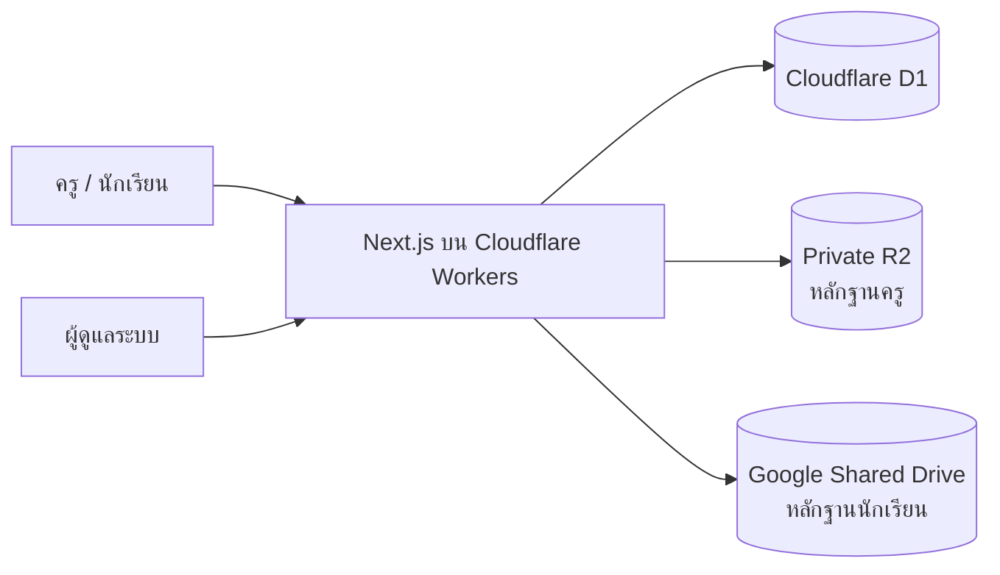

# EDU Pass — โรงเรียนจอมทอง

ระบบเว็บสำหรับรับและติดตามหลักฐานการสมัคร **EDU Pass** ของครู บุคลากร และนักเรียนโรงเรียนจอมทอง ผู้ส่งสามารถอ่านคำแนะนำ ตรวจสอบรายชื่อ และแนบภาพได้โดยไม่ต้องสร้างบัญชี ส่วนผู้ดูแลระบบสามารถติดตามความคืบหน้า ตรวจภาพหลักฐาน และจัดการข้อมูลผ่านแดชบอร์ดที่ป้องกันด้วยรหัสผ่าน

## สารบัญ

1. [ภาพรวมและเป้าหมาย](#1-ภาพรวมและเป้าหมาย)
2. [ความสามารถของระบบ](#2-ความสามารถของระบบ)
3. [บทบาทผู้ใช้งาน](#3-บทบาทผู้ใช้งาน)
4. [ขั้นตอนใช้งานสำหรับครูและบุคลากร](#4-ขั้นตอนใช้งานสำหรับครูและบุคลากร)
5. [ขั้นตอนใช้งานสำหรับนักเรียน](#5-ขั้นตอนใช้งานสำหรับนักเรียน)
6. [คู่มือผู้ดูแลระบบ](#6-คู่มือผู้ดูแลระบบ)
7. [การตั้งค่าระบบ](#7-การตั้งค่าระบบ)
8. [การนำเข้าและดูแลรายชื่อ](#8-การนำเข้าและดูแลรายชื่อ)
9. [สถาปัตยกรรมและการจัดเก็บไฟล์](#9-สถาปัตยกรรมและการจัดเก็บไฟล์)
10. [เส้นทางเว็บและ API](#10-เส้นทางเว็บและ-api)
11. [ความปลอดภัยและความเป็นส่วนตัว](#11-ความปลอดภัยและความเป็นส่วนตัว)
12. [ติดตั้งและรันในเครื่อง](#12-ติดตั้งและรันในเครื่อง)
13. [ตัวแปรสภาพแวดล้อม](#13-ตัวแปรสภาพแวดล้อม)
14. [ตั้งค่า Google Shared Drive](#14-ตั้งค่า-google-shared-drive)
15. [ฐานข้อมูลและ migrations](#15-ฐานข้อมูลและ-migrations)
16. [ตรวจสอบและเผยแพร่ระบบ](#16-ตรวจสอบและเผยแพร่ระบบ)
17. [การสำรองข้อมูลและงานดูแลประจำ](#17-การสำรองข้อมูลและงานดูแลประจำ)
18. [การแก้ปัญหาเบื้องต้น](#18-การแก้ปัญหาเบื้องต้น)
19. [โครงสร้างโปรเจกต์](#19-โครงสร้างโปรเจกต์)

## 1. ภาพรวมและเป้าหมาย

ระบบนี้จัดทำขึ้นเพื่อรวมขั้นตอนการส่งหลักฐาน EDU Pass ไว้ในจุดเดียว ลดการรับภาพผ่านหลายช่องทาง และทำให้ผู้ดูแลเห็นสถานะล่าสุดได้ทันที

เป้าหมายหลัก:

- ให้ครู บุคลากร และนักเรียนอ่านวิธีลงทะเบียนก่อนส่งหลักฐาน
- ให้ผู้ส่งตรวจสอบชื่อของตนเองจากรายชื่อที่โรงเรียนเตรียมไว้
- ลดความผิดพลาดจากการตั้งชื่อไฟล์และการแยกหลักฐานด้วยตนเอง
- แสดงจำนวนส่งแล้ว ค้างส่ง และเปอร์เซ็นต์ความคืบหน้า
- แยกแดชบอร์ดครูและนักเรียนออกจากกันอย่างชัดเจน
- จำกัดการดูภาพหลักฐานและการจัดการข้อมูลไว้เฉพาะผู้ดูแลระบบ

ระบบออนไลน์หลัก:

- เว็บไซต์: <https://edupass.ict-chomthong.com>
- Worker URL: <https://edupass.doitgict.workers.dev>

## 2. ความสามารถของระบบ

### 2.1 สำหรับครูและบุคลากร

- เลือกกลุ่มสาระหรือฝ่ายจากการ์ดข้อมูล
- ดูจำนวนทั้งหมด ส่งแล้ว และยังไม่ส่งของแต่ละกลุ่ม
- เปิดรายชื่อและกรองตามสถานะได้
- เลือกชื่อตนเองและตรวจสอบสถานะก่อนส่ง
- ดูภาพตัวอย่างหลักฐานที่ถูกต้อง
- แนบไฟล์ JPG, PNG หรือ WebP ตามค่าที่ผู้ดูแลกำหนด
- ส่งภาพใหม่แทนภาพเดิมได้เมื่อผู้ดูแลเปิดตัวเลือกส่งซ้ำ

### 2.2 สำหรับนักเรียน

- กรอกเลขประจำตัวนักเรียนเพื่อค้นหาข้อมูลจากฐานข้อมูล
- ตรวจสอบชื่อ นามสกุล ชั้น ห้อง และครูที่ปรึกษา
- ยืนยันว่าข้อมูลถูกต้องก่อนแนบหลักฐาน
- จัดเก็บภาพใน Google Shared Drive แยกตามระดับชั้นและห้อง
- ใช้เลขประจำตัวนักเรียนเป็นชื่อไฟล์โดยอัตโนมัติ

### 2.3 สำหรับผู้ดูแลระบบ

- แดชบอร์ดครู แสดงจำนวนรวม ส่งแล้ว ค้าง และความคืบหน้า
- ดูความคืบหน้าครูแยกตามกลุ่มสาระ
- ค้นหา กรอง ดูภาพ และลบรายชื่อครู
- แดชบอร์ดนักเรียน แสดงสถิติแยกจากข้อมูลครู
- กรองนักเรียนตามระดับชั้น ห้อง สถานะ ชื่อ เลขประจำตัว หรือครูที่ปรึกษา
- Stat card นักเรียนเปลี่ยนตามตัวกรองที่เลือก
- กดระดับชั้นเพื่อเปิด Modal สถิติรายห้อง
- ดูจำนวนทั้งหมด ส่งแล้ว ค้าง เปอร์เซ็นต์ และครูที่ปรึกษาของแต่ละห้อง
- กดห้องใน Modal เพื่อกรองรายชื่อนักเรียนห้องนั้น
- ดูภาพหลักฐานผ่าน API ที่ตรวจสิทธิ์ผู้ดูแล
- นำเข้ารายชื่อครูด้วย CSV พร้อมตรวจข้อมูลก่อนบันทึก
- กำหนดชนิดไฟล์ ขนาดไฟล์ วันปิดรับ และการส่งซ้ำ

## 3. บทบาทผู้ใช้งาน

### 3.1 ครูและบุคลากร

ไม่ต้องเข้าสู่ระบบ ผู้ใช้เลือกกลุ่มสาระและเลือกชื่อจากรายชื่อที่มีอยู่ การเลือกชื่อเป็นขั้นตอนระบุรายการที่จะส่งหลักฐาน ไม่ใช่การยืนยันตัวตนแบบบัญชีผู้ใช้

### 3.2 นักเรียน

ไม่ต้องเข้าสู่ระบบ นักเรียนต้องกรอกเลขประจำตัวที่ตรงกับฐานข้อมูล ระบบจึงจะแสดงชื่อ ชั้น ห้อง และครูที่ปรึกษา เลขประจำตัวทำหน้าที่ค้นหาและยืนยันข้อมูลเบื้องต้น ไม่ใช่รหัสผ่าน

### 3.3 ผู้ดูแลระบบ

ต้องเข้าสู่ระบบด้วยชื่อผู้ใช้และรหัสผ่านผู้ดูแล จึงจะเข้าถึงแดชบอร์ด การตั้งค่า รายชื่อ และภาพหลักฐานได้ Session มีอายุ 8 ชั่วโมง

> ห้ามเผยแพร่ชื่อผู้ใช้ รหัสผ่าน ค่าแฮชรหัสผ่าน กุญแจ session หรือ Service Account ใน README, Git หรือช่องทางสาธารณะ

## 4. ขั้นตอนใช้งานสำหรับครูและบุคลากร

1. เปิดหน้าหลักและเลือก **ครูและบุคลากร**
2. อ่านคำแนะนำ 3 ขั้นตอน
   - ดาวน์โหลดแอป EDU Pass
   - ลงทะเบียนผ่าน ThaID และกรอกข้อมูลเพิ่มเติม
   - แคปภาพหน้าแรกหลังลงทะเบียนสำเร็จ
3. กด **ส่งหลักฐาน**
4. เลือกกลุ่มสาระหรือฝ่าย
5. ใช้ Badge กรอง **ทั้งหมด**, **ส่งแล้ว** หรือ **ยังไม่ส่ง**
6. เลือกชื่อของตนเอง
7. ตรวจสอบชื่อ กลุ่มสาระ และสถานะ
8. เปิดดูภาพตัวอย่างหากไม่แน่ใจว่าต้องแนบภาพใด
9. เลือกไฟล์ภาพแล้วตรวจภาพตัวอย่างก่อนส่ง
10. กด **ส่งหลักฐาน** และรอข้อความยืนยัน

หากรายชื่อแสดงว่าส่งแล้วและระบบไม่อนุญาตให้ส่งซ้ำ ผู้ใช้ต้องติดต่อผู้ดูแลระบบ

## 5. ขั้นตอนใช้งานสำหรับนักเรียน

1. เปิดหน้าหลักและเลือก **นักเรียน**
2. อ่านคำแนะนำการลงทะเบียนและเตรียมภาพหน้าแรกของ EDU Pass
3. กด **ส่งหลักฐาน**
4. กรอกเลขประจำตัวนักเรียน
5. กดตรวจสอบรายชื่อ
6. ตรวจชื่อ นามสกุล ชั้น ห้อง และครูที่ปรึกษา
7. ทำเครื่องหมายยืนยันว่าข้อมูลถูกต้อง
8. เลือกภาพหลักฐานจากอุปกรณ์
9. ตรวจภาพตัวอย่างและกดส่ง

เมื่อส่งสำเร็จ ระบบจะสร้างโฟลเดอร์ระดับชั้นและห้องใน Google Shared Drive ตามความจำเป็น แล้วบันทึกภาพด้วยเลขประจำตัวนักเรียน เช่น:

```text
โฟลเดอร์หลัก/
└── ม.1/
    └── ห้อง 1/
        └── 23964.jpg
```

## 6. คู่มือผู้ดูแลระบบ

เข้าเมนู **ผู้ดูแลระบบ** หรือเปิด `/admin` แล้วเข้าสู่ระบบ

### 6.1 สรุปข้อมูลครู

หน้า `/admin` มีเฉพาะข้อมูลครูและบุคลากร:

- ครูและบุคลากรทั้งหมด
- จำนวนส่งหลักฐานแล้ว
- จำนวนยังไม่ส่ง
- เปอร์เซ็นต์ความคืบหน้า
- ความคืบหน้าแยกตามกลุ่มสาระ
- ตารางรายชื่อครูและบุคลากร

ตัวกรองที่รองรับ:

- ค้นหาชื่อ
- เลือกกลุ่มสาระ
- เลือกสถานะส่งแล้วหรือยังไม่ส่ง

ผู้ดูแลสามารถเปิดภาพหลักฐานของรายการที่มีไฟล์ และลบรายชื่อพร้อมหลักฐานที่เกี่ยวข้องได้ การลบไม่สามารถย้อนกลับได้

### 6.2 สรุปข้อมูลนักเรียน

หน้า `/admin/students` มีเฉพาะข้อมูลนักเรียน:

- นักเรียนทั้งหมดหรือจำนวนนักเรียนที่ตรงกับตัวกรอง
- จำนวนส่งแล้ว
- จำนวนค้างส่ง
- เปอร์เซ็นต์ความคืบหน้า
- การ์ดความคืบหน้า ม.1–ม.6
- Modal สถิติรายห้อง
- รายชื่อนักเรียน เลขประจำตัว ชั้น ห้อง ครูที่ปรึกษา และสถานะ

ตัวกรองที่รองรับ:

- เลขประจำตัวนักเรียน
- ชื่อหรือนามสกุล
- ชื่อครูที่ปรึกษา
- ระดับชั้น
- ห้อง
- สถานะส่งแล้วหรือยังไม่ส่ง

เมื่อมีตัวกรอง Stat card ทั้ง 4 ใบจะคำนวณจากผลลัพธ์ที่กรองแล้ว ส่วนการ์ดระดับชั้นและ Modal รายห้องแสดงภาพรวมของทุกระดับชั้นจากฐานข้อมูล

### 6.3 ความหมายของสถานะ

- **ส่งแล้ว**: ระบบได้รับไฟล์หลักฐาน หรือผู้ดูแลเคยกำหนดสถานะครูว่าส่งแล้ว
- **ยังไม่ส่ง/ค้าง**: ยังไม่มีไฟล์และไม่มีสถานะส่งแล้ว
- สถานะส่งแล้วไม่ได้หมายถึงการอนุมัติ การตรวจสอบตัวตน หรือการรับรองความถูกต้องของข้อมูลในภาพ

### 6.4 การออกจากระบบ

กดเมนูออกจากระบบเพื่อยกเลิก cookie ในเบราว์เซอร์ หากต้องการยกเลิก session ของผู้ดูแลทุกอุปกรณ์ ให้เปลี่ยน `ADMIN_SESSION_SECRET` แล้ว deploy ใหม่

## 7. การตั้งค่าระบบ

หน้า `/admin/settings` รองรับค่าต่อไปนี้:

| ค่า | รายละเอียด | ค่าเริ่มต้น |
|---|---|---|
| ขนาดไฟล์สูงสุด | ตั้งได้ 1–20 MB | 5 MB |
| ชนิดไฟล์ | JPG, PNG และ WebP | เปิดทั้งหมด |
| กำหนดส่ง | วันที่สิ้นสุดตามเวลาไทย | ไม่กำหนด |
| ปิดรับหลังครบกำหนด | ปฏิเสธไฟล์ใหม่หลัง 23:59:59 น. ของวันกำหนดส่ง | ปิด |
| อนุญาตส่งซ้ำ | ให้ภาพใหม่แทนภาพเดิม | ปิด |
| ข้อมูลที่ต้องปรากฏในภาพ | ข้อความคำแนะนำเพิ่มเติมในหน้าส่งหลักฐานครู | เว้นว่าง |

การตั้งค่าขนาดไฟล์ ชนิดไฟล์ วันปิดรับ และการส่งซ้ำมีผลกับทั้งครูและนักเรียน

## 8. การนำเข้าและดูแลรายชื่อ

### 8.1 รายชื่อครูและบุคลากร

เปิด `/admin/import` เพื่อดาวน์โหลดแม่แบบและนำเข้า CSV แบบ UTF-8

คอลัมน์:

| คอลัมน์ | จำเป็น | รายละเอียด |
|---|---:|---|
| `กลุ่มสาระ` | ใช่ | ชื่อกลุ่มสาระ ฝ่าย หรือหน่วยงาน |
| `ชื่อ-นามสกุล` | ใช่ | ใช้ร่วมกับกลุ่มสาระเป็นรายการไม่ซ้ำ |
| `ตำแหน่ง` | ไม่ | เช่น ครู เจ้าหน้าที่ ผู้บริหาร |
| `อีเมล` | ไม่ | เก็บเป็นข้อมูลประกอบ ไม่ใช้เข้าสู่ระบบ |

ข้อจำกัด:

- ไฟล์ไม่เกิน 1 MB
- ไม่เกิน 3,000 แถว
- ระบบรองรับข้อความในเครื่องหมายคำพูดและ comma ภายใน cell
- ระบบแสดงสถานะใหม่ อัปเดต ไม่เปลี่ยนแปลง ซ้ำ ไม่ครบ และไม่ถูกต้องก่อนยืนยัน
- การนำเข้าเพิ่มหรืออัปเดตข้อมูล แต่ไม่ลบรายชื่อเดิม
- กลุ่มสาระใหม่จะถูกสร้างอัตโนมัติ

### 8.2 รายชื่อนักเรียน

ข้อมูลนักเรียนประกอบด้วย:

- เลขประจำตัวนักเรียนที่ไม่ซ้ำ
- ชื่อและนามสกุล
- ชั้น/ห้องในรูปแบบ `1/1`, `2/5` เป็นต้น
- ชื่อครูที่ปรึกษา

ขณะนี้หน้า Import รองรับรายชื่อครูเท่านั้น การเพิ่มหรือปรับปรุงรายชื่อนักเรียนต้องดำเนินการผ่านขั้นตอนนำเข้าฐานข้อมูลที่ผู้ดูแลโครงการตรวจสอบแล้ว ควรสำรอง D1 และตรวจเลขประจำตัวซ้ำก่อนนำเข้าทุกครั้ง

## 9. สถาปัตยกรรมและการจัดเก็บไฟล์



### 9.1 Cloudflare D1

เก็บรายชื่อ กลุ่มสาระ สถานะ การตั้งค่า metadata ของหลักฐาน ข้อมูลจำกัดการเข้าสู่ระบบ และ audit log โดยไม่เก็บ binary ของภาพ

### 9.2 Cloudflare R2

เก็บหลักฐานของครูและบุคลากรใน bucket `edupass-evidence` ด้วย object key แบบสุ่ม เช่น `evidence/<uuid>.jpg` Bucket ต้องเป็น private และเปิดภาพผ่าน API ผู้ดูแลเท่านั้น

### 9.3 Google Shared Drive

เก็บหลักฐานนักเรียน แยกโฟลเดอร์เป็นระดับชั้นและห้อง ใช้เลขประจำตัวเป็นชื่อไฟล์ D1 เก็บเฉพาะ Google Drive File ID และ metadata ที่จำเป็น

หากมีการส่งซ้ำ ระบบจะอัปโหลดไฟล์ใหม่ บันทึก File ID ใหม่ แล้วนำไฟล์เดิมไปไว้ในถังขยะหลังบันทึกสำเร็จ

### 9.4 เทคโนโลยีหลัก

| ส่วน | เทคโนโลยี |
|---|---|
| Web framework | Next.js 16 และ React 19 |
| ภาษา | TypeScript 7 |
| UI | Tailwind CSS 4 และ Font Awesome 7 |
| Runtime | Cloudflare Workers ผ่าน OpenNext for Cloudflare |
| ฐานข้อมูล | Cloudflare D1 |
| หลักฐานครู | Cloudflare R2 แบบ private |
| หลักฐานนักเรียน | Google Drive API และ Google Shared Drive |
| Authentication | PBKDF2-SHA256 และ JWT ด้วย `jose` |
| Tests | Vitest |

## 10. เส้นทางเว็บและ API

### 10.1 หน้าเว็บ

| เส้นทาง | ผู้ใช้ | หน้าที่ |
|---|---|---|
| `/` | ทุกคน | เลือกครู/บุคลากรหรือนักเรียน |
| `/guide/teacher` | ทุกคน | คำแนะนำสำหรับครูและบุคลากร |
| `/guide/student` | ทุกคน | คำแนะนำสำหรับนักเรียน |
| `/submit` | ครู/บุคลากร | เลือกรายชื่อและส่งหลักฐาน |
| `/student/submit` | นักเรียน | ตรวจเลขประจำตัวและส่งหลักฐาน |
| `/admin` | ผู้ดูแล | สรุปข้อมูลครู |
| `/admin/students` | ผู้ดูแล | สรุปข้อมูลนักเรียนและสถิติรายห้อง |
| `/admin/import` | ผู้ดูแล | นำเข้ารายชื่อครูด้วย CSV |
| `/admin/settings` | ผู้ดูแล | ตั้งค่าการรับไฟล์และกำหนดส่ง |

### 10.2 API สาธารณะ

| Method | เส้นทาง | หน้าที่ |
|---|---|---|
| `GET` | `/api/me` | ตรวจสถานะ session ผู้ดูแลสำหรับส่วนติดต่อผู้ใช้ |
| `GET` | `/api/staff` | คืนรายชื่อและสถานะครูในกลุ่มสาระที่เลือก |
| `POST` | `/api/submissions` | รับหลักฐานครูและบันทึกลง R2 |
| `POST` | `/api/students/lookup` | ค้นหานักเรียนด้วยเลขประจำตัว |
| `POST` | `/api/student-submissions` | รับหลักฐานนักเรียนและส่งไป Google Drive |

### 10.3 API ผู้ดูแล

ทุกเส้นทางตรวจ session ฝั่ง server:

- `/api/admin/login` และ `/api/admin/logout`
- `/api/admin/summary`
- `/api/admin/staff` และ `/api/admin/staff/[id]`
- `/api/admin/students`
- `/api/admin/evidence/[staffId]`
- `/api/admin/student-evidence/[studentId]`
- `/api/admin/import/preview`
- `/api/admin/import/commit`
- `/api/admin/settings`

## 11. ความปลอดภัยและความเป็นส่วนตัว

ระบบมีมาตรการหลักดังนี้:

- รหัสผ่านผู้ดูแลแฮชด้วย PBKDF2-SHA256 จำนวน 100,000 รอบ
- Session ใช้ JWT แบบ HS256 อายุ 8 ชั่วโมง
- Cookie เป็น `HttpOnly`, `SameSite=Strict` และ `Secure` เมื่อใช้ HTTPS
- จำกัดการลองเข้าสู่ระบบผิดเกิน 10 ครั้งในช่วง 15 นาทีต่อ client
- คำขอที่เปลี่ยนข้อมูลต้องมี Origin ตรงกับเว็บไซต์เพื่อช่วยป้องกัน CSRF
- ตรวจชนิดไฟล์จาก magic bytes ไม่เชื่อเฉพาะนามสกุลหรือ Content-Type
- จำกัดชนิดและขนาดไฟล์ทั้งฝั่งหน้าจอและ server
- ใช้คำสั่งฐานข้อมูลแบบ bind parameters เพื่อลดความเสี่ยง SQL injection
- ภาพหลักฐานไม่เปิด public access
- การดูภาพผ่าน API ต้องมี session ผู้ดูแล
- มี audit log สำหรับการเข้าสู่ระบบ การตั้งค่า การนำเข้า การส่ง และการดูหลักฐาน
- ตั้ง response headers ป้องกันการฝัง iframe, MIME sniffing และปิดการทำดัชนีของ search engine

ข้อควรปฏิบัติ:

- ไม่เก็บ `.dev.vars`, `.admin-credentials` หรือไฟล์ Service Account JSON ใน Git
- ไม่เปิด R2 bucket เป็น public
- ไม่ใช้ Cloudflare Access ครอบหน้าสาธารณะที่ครูและนักเรียนต้องส่งหลักฐาน
- จำกัดสมาชิก Google Shared Drive เฉพาะผู้ที่จำเป็น
- เปลี่ยนรหัสผ่านและ session secret เมื่อสงสัยว่าข้อมูลรั่วไหล

## 12. ติดตั้งและรันในเครื่อง

### 12.1 ความต้องการ

- Node.js รุ่นที่รองรับ dependency ใน `package-lock.json`
- npm
- บัญชี Cloudflare สำหรับ preview/deploy ระบบออนไลน์
- Google Cloud Service Account และ Shared Drive หากต้องการทดสอบหลักฐานนักเรียนจริง

### 12.2 ติดตั้ง

```bash
npm install
cp .dev.vars.example .dev.vars
npm run setup:admin
npm run db:migrate:local
npm run dev
```

เปิด <http://localhost:3001>

คำสั่ง `npm run setup:admin` สร้างข้อมูลรับรองสำหรับเครื่องนั้นและบันทึกค่าที่จำเป็นลงไฟล์ local ซึ่งถูกยกเว้นจาก Git

ข้อมูล D1 ในเครื่องเก็บใต้ `.wrangler/state` อย่าลบโฟลเดอร์นี้หากยังไม่ได้สำรองข้อมูล รายชื่อใน local และ production แยกจากกัน

### 12.3 คำสั่งที่ใช้บ่อย

```bash
npm run dev              # รัน development server ที่ port 3001
npm run typecheck        # ตรวจ TypeScript
npm test                 # รัน Vitest
npm run build            # สร้าง Next.js production build
npm run preview          # build และ preview ด้วย OpenNext Cloudflare
npm run cf-typegen       # สร้าง type ของ Cloudflare bindings
npm run db:migrate:local # ใช้ migrations กับ D1 local
npm run db:migrate:prod  # ใช้ migrations กับ D1 production
npm run deploy           # build และ deploy production Worker
```

## 13. ตัวแปรสภาพแวดล้อม

ตัวอย่างอยู่ใน `.dev.vars.example`

| ตัวแปร | จำเป็น | รายละเอียด |
|---|---:|---|
| `ADMIN_USERNAME` | ใช่ | ชื่อผู้ใช้ผู้ดูแล |
| `ADMIN_PASSWORD_HASH` | ใช่ | ค่า PBKDF2 hash ที่สร้างจาก script |
| `ADMIN_SESSION_SECRET` | ใช่ | กุญแจลงนาม session อย่างน้อย 32 ตัวอักษร |
| `GOOGLE_SERVICE_ACCOUNT_EMAIL` | สำหรับนักเรียน | อีเมล Service Account |
| `GOOGLE_SERVICE_ACCOUNT_PRIVATE_KEY` | สำหรับนักเรียน | Private key โดยเก็บ newline เป็น `\n` |
| `GOOGLE_DRIVE_FOLDER_ID` | สำหรับนักเรียน | Folder ID ของโฟลเดอร์หลักใน Shared Drive |

Production secrets ต้องตั้งด้วย Wrangler และไม่ควรเขียนลง `wrangler.jsonc`:

```bash
npx wrangler secret put ADMIN_PASSWORD_HASH --env production
npx wrangler secret put ADMIN_SESSION_SECRET --env production
npx wrangler secret put GOOGLE_SERVICE_ACCOUNT_EMAIL --env production
npx wrangler secret put GOOGLE_SERVICE_ACCOUNT_PRIVATE_KEY --env production
npx wrangler secret put GOOGLE_DRIVE_FOLDER_ID --env production
```

`ADMIN_USERNAME` และ binding ที่ไม่เป็นความลับกำหนดใน `wrangler.jsonc`

## 14. ตั้งค่า Google Shared Drive

1. สร้าง Google Cloud project หรือใช้ project ของหน่วยงาน
2. เปิด Google Drive API
3. สร้าง Service Account และ key
4. สร้างโฟลเดอร์หลักใน Shared Drive ของโรงเรียน
5. เพิ่ม Service Account เป็นสมาชิก Shared Drive ที่มีสิทธิ์จัดการเนื้อหา
6. คัดลอก Folder ID จาก URL ของโฟลเดอร์หลัก
7. ตั้งค่า secrets ทั้งสามรายการ
8. ทดสอบ upload และ cleanup ก่อนเปิดใช้งานจริง

ทดสอบจากเครื่องโดยใช้ไฟล์ Service Account ชั่วคราวที่อยู่นอก Git:

```bash
GOOGLE_APPLICATION_CREDENTIALS=/absolute/path/service-account.json \
GOOGLE_DRIVE_FOLDER_ID=<folder-id> \
node scripts/verify-google-drive.mjs
```

เมื่อทดสอบสำเร็จ script จะอัปโหลดไฟล์ข้อความชั่วคราวและนำไฟล์นั้นไปไว้ในถังขยะโดยอัตโนมัติ

## 15. ฐานข้อมูลและ migrations

ตารางหลัก:

| ตาราง | หน้าที่ |
|---|---|
| `departments` | กลุ่มสาระ ฝ่าย หรือหน่วยงาน |
| `staff` | รายชื่อครูและบุคลากร |
| `submissions` | metadata หลักฐานครูและ R2 object key |
| `students` | เลขประจำตัว ชื่อ ชั้น/ห้อง และครูที่ปรึกษา |
| `student_submissions` | metadata หลักฐานนักเรียนและ Drive File ID |
| `settings` | การตั้งค่าระบบ |
| `audit_log` | ประวัติการกระทำสำคัญ |
| `admin_login_attempts` | จำกัดการลองเข้าสู่ระบบ |
| `admin_accounts` | บัญชีผู้ดูแลเพิ่มเติมและรหัสผ่านแบบ hash |
| `google_drive_folders` | แคช Folder ID แยกชั้น/ห้อง เพื่อลดคำขอ Google Drive ระหว่างอัปโหลด |

ไฟล์ migration อยู่ใน `migrations/` และต้องรันตามลำดับ:

- `0001_init.sql` โครงสร้างครู หลักฐาน การตั้งค่า และ audit log
- `0002_staff_position.sql` เพิ่มตำแหน่งบุคลากร
- `0003_admin_login.sql` เพิ่มข้อมูลจำกัดการเข้าสู่ระบบ
- `0004_manual_submission_status.sql` รองรับสถานะส่งแล้วก่อนมีไฟล์
- `0005_students_google_drive.sql` เพิ่มนักเรียนและหลักฐาน Google Drive
- `0006_student_advisor.sql` เพิ่มครูที่ปรึกษา
- `0007_admin_accounts.sql` รองรับบัญชีผู้ดูแลเพิ่มเติม
- `0008_google_drive_folder_cache.sql` แคชโฟลเดอร์ Google Drive เพื่อลดคอขวดเมื่อส่งพร้อมกัน

ก่อนใช้ migration กับ production ควรสำรองฐานข้อมูลและอ่าน SQL ทุกครั้ง

## 16. ตรวจสอบและเผยแพร่ระบบ

### 16.1 ตรวจโค้ดก่อน deploy

```bash
npm run typecheck
npm test
npm run build
```

### 16.2 ใช้ migrations กับ production

```bash
npm run db:migrate:prod
```

### 16.3 Deploy

```bash
npm run deploy
```

หลัง deploy ควรตรวจอย่างน้อย:

1. หน้าหลักและภาพตัวอย่างโหลดได้
2. หน้าส่งครูเปิดกลุ่มสาระและรายชื่อได้
3. นักเรียนค้นหาด้วยเลขประจำตัวได้
4. ผู้ดูแลเข้าสู่ระบบได้
5. หน้า `/admin` ไม่มีข้อมูลนักเรียนปน
6. หน้า `/admin/students` แสดงระดับชั้น ห้อง และครูที่ปรึกษาถูกต้อง
7. Modal รายห้องกรองรายชื่อได้
8. เปิดภาพหลักฐานครูจาก R2 ได้
9. เปิดภาพหลักฐานนักเรียนจาก Google Drive ได้

## 17. การสำรองข้อมูลและงานดูแลประจำ

ควรดำเนินการดังนี้:

- สำรอง D1 ก่อน migration หรือนำเข้ารายชื่อจำนวนมาก
- ตรวจจำนวนรายชื่อครู นักเรียน ชั้น ห้อง และครูที่ปรึกษาหลังนำเข้า
- ตรวจพื้นที่ R2 และ Google Shared Drive เป็นระยะ
- ตรวจ audit log เมื่อพบการเปลี่ยนแปลงที่ไม่คาดคิด
- ตรวจรายการที่ส่งซ้ำและไฟล์ในถังขยะของ Google Drive
- ทดสอบบัญชีผู้ดูแลหลังเปลี่ยน secret
- ตรวจวันปิดรับและตัวเลือกปิดรับก่อนประกาศใช้งาน
- ตรวจภาพตัวอย่างเมื่อหน้าตาแอป EDU Pass เปลี่ยน

## 18. การแก้ปัญหาเบื้องต้น

### ผู้ดูแลเข้าสู่ระบบไม่ได้

- ตรวจ `ADMIN_USERNAME`
- ตรวจว่าตั้ง `ADMIN_PASSWORD_HASH` และ `ADMIN_SESSION_SECRET` ใน environment ที่ deploy จริง
- สำหรับบัญชีเพิ่มเติม ให้ตรวจสถานะ `active` และค่า `password_hash` ในตาราง `admin_accounts`
- รอให้ช่วงจำกัดการเข้าสู่ระบบ 15 นาทีสิ้นสุด หากกรอกผิดเกินกำหนด
- สร้างข้อมูลรับรองใหม่ด้วย `npm run setup:admin` สำหรับ local

### ครูหรือนักเรียนส่งไฟล์ไม่ได้

- ตรวจขนาดและชนิดไฟล์ในการตั้งค่า
- ตรวจวันกำหนดส่งและตัวเลือกปิดรับ
- ตรวจว่ารายชื่อนั้นส่งแล้วและปิดการส่งซ้ำอยู่หรือไม่
- ตรวจ magic bytes ของไฟล์ โดยเฉพาะไฟล์ที่เปลี่ยนนามสกุลเอง

### หลักฐานครูเปิดไม่ได้

- ตรวจ R2 binding `EVIDENCE`
- ตรวจว่า bucket ถูกผูกกับ environment ถูกต้อง
- ตรวจ object key ใน `submissions`
- อย่าแก้ด้วยการเปิด bucket เป็น public

### หลักฐานนักเรียนส่งหรือเปิดไม่ได้

- ตรวจ Google Drive secrets ทั้งสามค่า
- ตรวจว่า Service Account ยังเป็นสมาชิก Shared Drive
- ตรวจสิทธิ์สร้างโฟลเดอร์ อัปโหลด อ่าน และย้ายไฟล์ลงถังขยะ
- รัน `scripts/verify-google-drive.mjs`

### ข้อมูล local ไม่ตรงกับออนไลน์

D1 local และ production เป็นคนละฐานข้อมูล การ migrate หรือ import ในเครื่องจะไม่อัปโหลดข้อมูลขึ้น production อัตโนมัติ

### หน้าเว็บยังแสดงไฟล์ภาพเดิม

- ตรวจชื่อและเส้นทางไฟล์ใน `public/`
- ตรวจว่า deploy มี asset ใหม่
- รีเฟรชแบบไม่ใช้ cache หรือรอ Cloudflare asset propagation

## 19. โครงสร้างโปรเจกต์

```text
EduPass/
├── migrations/                 # Cloudflare D1 migrations
├── public/
│   ├── brand/                  # โลโก้โรงเรียน
│   ├── examples/               # ภาพตัวอย่าง EDU Pass
│   └── templates/              # แม่แบบ CSV
├── scripts/
│   ├── setup-admin.mjs         # สร้างข้อมูลรับรองผู้ดูแล local
│   └── verify-google-drive.mjs # ทดสอบ Google Drive
├── src/
│   ├── app/                    # Next.js pages และ route handlers
│   ├── components/             # ฟอร์ม แดชบอร์ด Modal และ UI
│   └── lib/                    # auth, DB, CSV, Drive, validation
├── .dev.vars.example           # ตัวอย่าง environment variables
├── open-next.config.ts         # OpenNext Cloudflare config
├── wrangler.jsonc              # Worker, D1 และ R2 bindings
└── package.json                # dependencies และ scripts
```

ไฟล์สำคัญ:

- `src/components/RegistrationGuide.tsx` คำแนะนำ 3 ขั้นตอน
- `src/components/SubmitForm.tsx` ขั้นตอนส่งหลักฐานครู
- `src/components/StudentSubmitForm.tsx` ขั้นตอนส่งหลักฐานนักเรียน
- `src/components/AdminDashboard.tsx` สรุปข้อมูลครู
- `src/components/StudentAdminDashboard.tsx` สรุปข้อมูลนักเรียนและ Modal รายห้อง
- `src/lib/auth.ts` รหัสผ่าน session และ cookie ผู้ดูแล
- `src/lib/file-validate.ts` ตรวจไฟล์จากข้อมูลจริง
- `src/lib/google-drive.ts` เชื่อมต่อ Google Drive แบบ server-to-server
- `src/lib/settings.ts` ค่าเริ่มต้นและ validation ของการตั้งค่า

---

ระบบนี้ใช้สำหรับรับและติดตามหลักฐานเท่านั้น สถานะ **ส่งแล้ว** หมายถึงระบบได้รับไฟล์หรือมีการบันทึกสถานะ ไม่ได้หมายถึงการอนุมัติหรือรับรองข้อมูลในหลักฐาน
